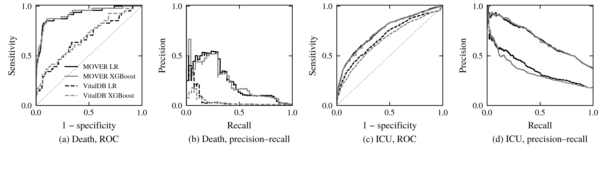
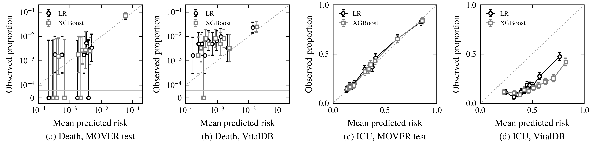
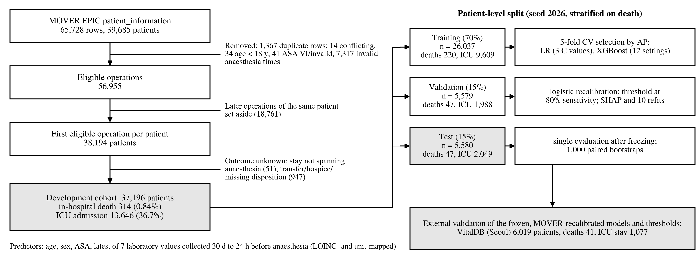
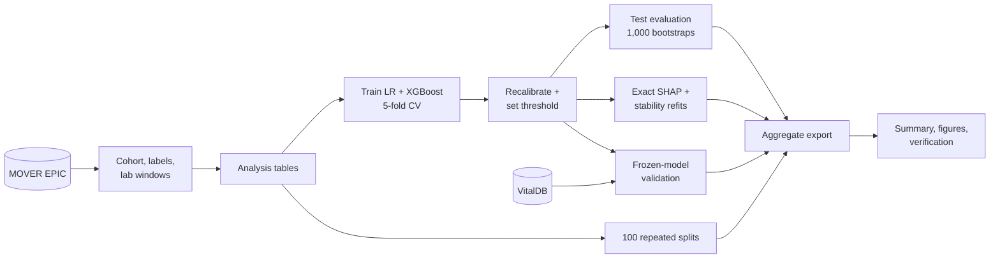

# PreOp-XAI

**Explainable preoperative risk prediction: does gradient boosting actually beat logistic regression?**

PreOp-XAI compares L2 logistic regression with XGBoost for predicting **in-hospital mortality** and
**ICU admission** from ten variables available before surgery. It goes beyond a single AUROC and
tests whether the models stay calibrated, whether their explanations are stable, and whether they
hold up at a different hospital.

- **Development cohort:** MOVER EPIC EMR, 37,196 surgical patients
- **External validation:** VitalDB, 6,019 patients, with models frozen before testing
- **Explanations:** exact interventional SHAP, checked against brute-force Shapley values
- **Robustness:** 1,000 bootstraps, 10 stability refits and 100 repeated splits per endpoint
- **Reproducible:** locked environment, fixed seeds and an automated determinism check

## Research questions

1. Does XGBoost discriminate better than a well-specified logistic regression on routine
   preoperative data?
2. Are predicted probabilities well calibrated after recalibration?
3. Are SHAP explanations stable when the model is refitted?
4. Does performance transport to an independent surgical population?

## Results at a glance

<!-- results:start -->
| Endpoint | Model | MOVER test AUROC (95% CI) | 100-split median AUROC (2.5–97.5%) | VitalDB AUROC (95% CI) | VitalDB calibration slope |
| --- | --- | --- | --- | --- | --- |
| In-hospital mortality | L2 logistic regression | 0.916 (0.865–0.958) | 0.925 (0.882–0.952) | 0.671 (0.567–0.758) | 0.550 |
| In-hospital mortality | XGBoost | 0.923 (0.871–0.961) | 0.927 (0.884–0.951) | 0.687 (0.594–0.768) | 0.541 |
| ICU admission | L2 logistic regression | 0.752 (0.738–0.765) | 0.743 (0.733–0.756) | 0.688 (0.670–0.708) | 1.008 |
| ICU admission | XGBoost | 0.754 (0.740–0.768) | 0.745 (0.736–0.758) | 0.659 (0.639–0.680) | 0.720 |
<!-- results:end -->

*Generated from `results/` by `make table`.*

- **XGBoost and logistic regression perform almost identically** across the 100 repeated splits.
- **Performance falls at external validation**, especially for mortality, where VitalDB has few
  events and calibration transports poorly.
- **Calibration diagnostics have a documented numerical-stability issue.** See
  [Known limitations](docs/KNOWN_LIMITATIONS.md).

| Discrimination | Calibration |
| --- | --- |
|  |  |

| Cohort and protocol | Grouped SHAP importance |
| --- | --- |
|  |  |

## Pipeline



## Quickstart

Requires [uv](https://docs.astral.sh/uv/). Python 3.13 and all dependencies come from `uv.lock`.

```sh
make setup      # install the locked environment
make check      # validate dependencies and input files
make prepare    # build analysis tables from raw MOVER files
make protocol   # run the full study
make report     # generate the summary and figures
make verify     # SHAP self-test and strict comparison with results/
make test       # run the test suite
make all        # check, prepare, protocol, report and verify
```

A full run takes about 15 minutes on 16 cores with the default 6 workers. `make verify`, and so
`make all`, currently exits nonzero for the reason given in
[Known limitations](docs/KNOWN_LIMITATIONS.md).

## Data

MOVER and VitalDB are not distributed here. Obtain them under their own terms and place them as
described in [`data/README.md`](data/README.md). Paths are set in `config/paths.toml` and can be
overridden with environment variables.

Patient-level data, predictions and per-patient SHAP values never enter git. Only aggregate results
are committed, with calibration cells under 11 patients removed, and a test enforces this.

## Repository layout

```text
src/preopxai/    core modelling, calibration, evaluation, SHAP and stability
data_prep/       MOVER cohort, lab extraction, feature tables, VitalDB adapter
pipeline/        CLI, configuration, protocol, reporting, verification
config/          path configuration
data/            local data (ignored by git)
results/         committed aggregate results and figures
verification/    determinism, SHAP self-test, split check, environment record
docs/            methods, data, architecture, limitations, verification
tests/           pytest suite
```

## Documentation

- [Methods](docs/METHODS.md)
- [Data](docs/DATA.md)
- [Architecture](docs/ARCHITECTURE.md)
- [Known limitations](docs/KNOWN_LIMITATIONS.md)
- [Refactor verification](docs/REFACTOR_VERIFICATION.md)

## Team

B.Tech minor project, AI & Data Science, VIPS.

- **Project group:** Paarth Sharma, Manas Lahora, Yug Sharma
- **Supervisor:** Ms Anjani Gupta

*Research software. Not validated for clinical use.*
