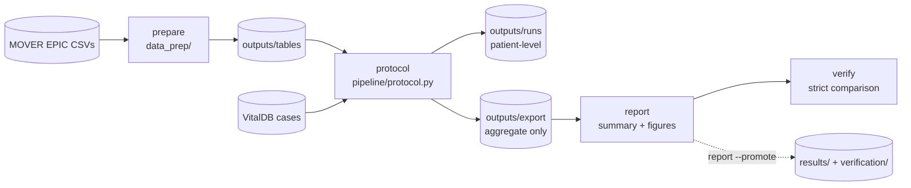

# Architecture

## Folders

| Path | Role |
| --- | --- |
| `src/preopxai/` | Core package: splits, training, calibration, evaluation, exact SHAP, stability, single-study runner (`study.py`) |
| `data_prep/` | MOVER cohort, lab extraction, feature tables, VitalDB adapter |
| `pipeline/` | CLI, path config, preparation, protocol, verification |
| `pipeline/reporting/` | Summary, figures, README table |
| `config/` | Path configuration |
| `results/` | Committed aggregate results and figures |
| `verification/` | Determinism check, SHAP self-test, split check, environment record, run log |
| `tests/` | pytest suite |
| `app/` | Dashboard: `build_data.py`, FastAPI backend (`api/`), React frontend (`web/`) and its tests |

## Stages

All stages run through one Typer CLI, `preopxai` (`pipeline/cli.py`). Run any of them as
`uv run preopxai <command>`; each has `--help`.

| Command | Output |
| --- | --- |
| `check` | Dependency and input validation |
| `prepare` | Analysis tables |
| `protocol [steps...]` | Models, metrics, SHAP, stability, repeats, export |
| `report [--promote]` | `summary.json`, figures as PNG, PDF and SVG; `--promote` copies them into `results/` and `verification/` and refreshes the README table |
| `verify` | SHAP self-test and strict comparison with `results/` |
| `all` | `check`, `prepare`, `protocol`, `report` and `verify`, in order |
| `export-models` | Primary-split models in `artifacts/`, verified against `results/` (not part of `all`) |
| `table [--check]` | README results table from `results/` |
| `test` | Site data, then the pytest suites in `tests/` and `app/tests/` |
| `app build [--static]` | Site data and the web frontend (`app/web/dist`, or the findings-only `dist-static`) |
| `app serve [--port]` | Frontend at `/` and API at `/api` on one port, bound to 127.0.0.1 |
| `app e2e`, `app screenshots` | Playwright smoke tests and `docs/screenshots` |

Protocol steps are `environment main lag0 rerun split_check repeats export`. Finished steps
are skipped, so an interrupted run can resume. To start clean, point `PREOPXAI_OUTPUTS` at an
empty folder.

## Configuration

`pipeline/config.py` is the only place paths are resolved. It reads `config/paths.toml`, and
`PREOPXAI_MOVER_RAW`, `PREOPXAI_VITALDB_CLINICAL`, `PREOPXAI_OUTPUTS` or `PREOPXAI_CONFIG`
override it. `PREOPXAI_WORKERS` changes parallelism only (default 6).

## Modules outside the main pipeline

`src/preopxai/` also contains a YAML-configured workflow (`cli.py`, `config.py`, `workflow.py`,
`cohort.py`, `labels.py`, `features.py`, `audit.py`, `status.py`, `demo.py`, `inference.py`).
It needs `pyyaml` and `polars`, which are not in the locked environment, and the pipeline and
the `preopxai` command do not call it.
